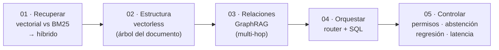
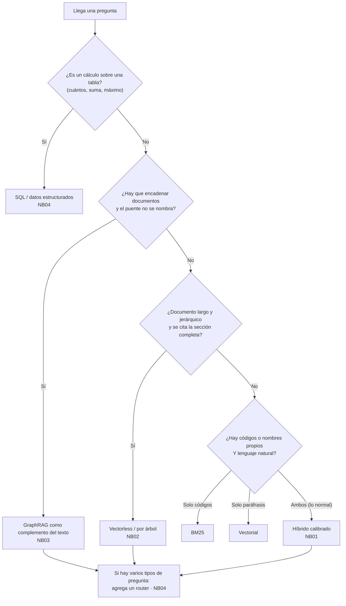
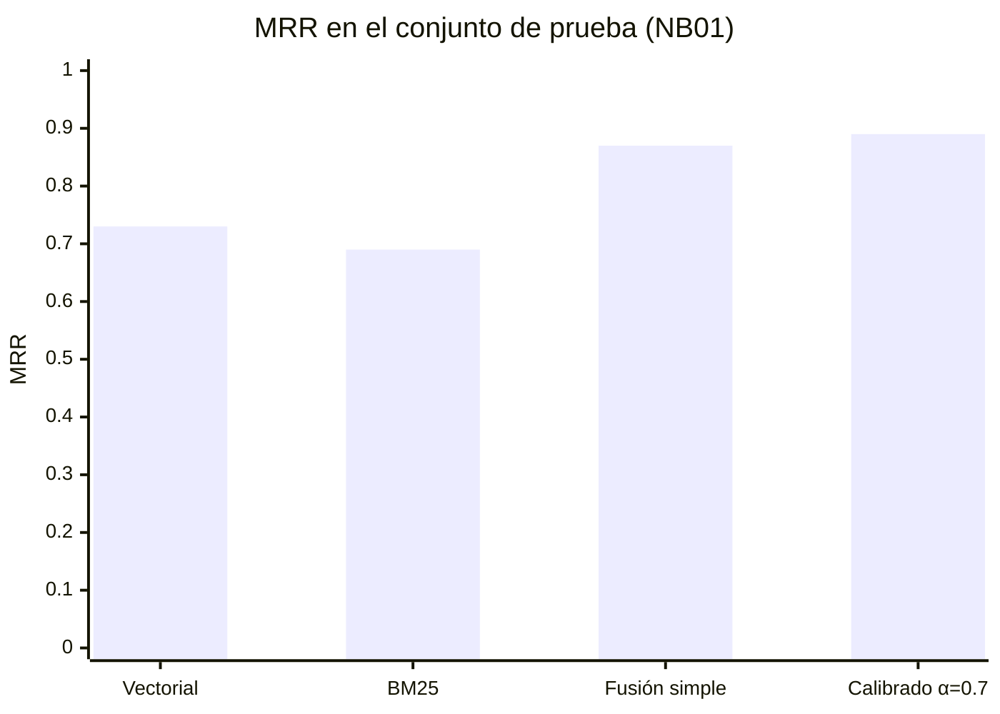
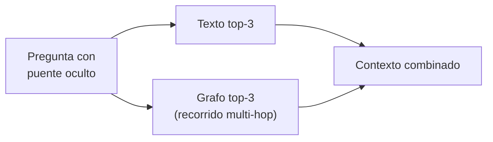
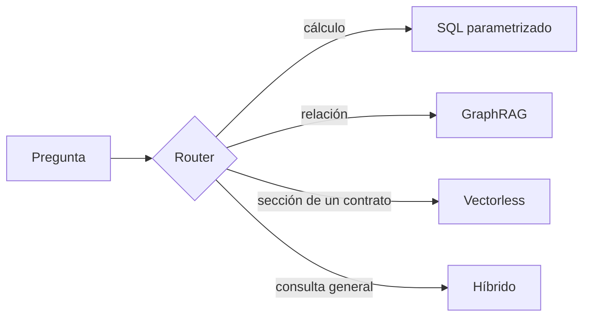
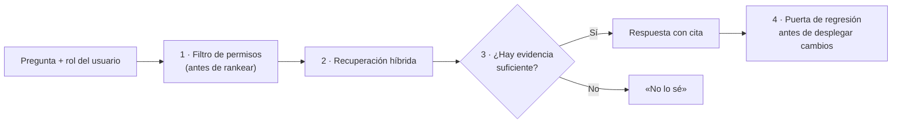

# Webinar · RAG para Soluciones Productivas

**¿Qué RAG necesito?** (RAG = *Retrieval-Augmented Generation*: buscar en tus documentos y responder con ellos.) Se decide por el *tipo de pregunta* y la *forma de los datos*, no por moda.
Este repo reúne cinco notebooks de Google Colab que lo demuestran con mediciones reproducibles: sin claves de API y sin GPU.

> Los datos son sintéticos y pequeños (42 documentos, 33 consultas de la empresa ficticia «Andina Retail»).
> Los resultados ilustran un criterio de decisión; **no son una medición de producción** ni generalizan a otros corpus. Mide con tus propias preguntas.

## Las diapositivas

[`slides/webinar-rag.html`](slides/webinar-rag.html) es el deck del webinar (32 diapositivas, un solo archivo HTML que funciona sin internet). Descárgalo y ábrelo en tu navegador: navega con las flechas, `G` muestra la vista general y `D` cambia a modo oscuro.

## Los notebooks

| # | Notebook | Familia | Pregunta que responde | Abrir |
|---|---|---|---|---|
| 01 | Vectorial, palabra clave e híbrido | vectorial · BM25 · híbrido | ¿Quién recupera mejor, y cuánto aporta calibrar? | [](https://colab.research.google.com/github/manuel-arguelles-ai/webinar-rag-familias/blob/main/notebooks/01_vectorial_keyword_hibrido.ipynb) |
| 02 | Vectorless: árbol de documento | vectorless | ¿Navegar la estructura vence a trocear? | [](https://colab.research.google.com/github/manuel-arguelles-ai/webinar-rag-familias/blob/main/notebooks/02_vectorless_arbol_de_documento.ipynb) |
| 03 | GraphRAG y multi-hop | GraphRAG | ¿Cuándo el grafo suma sobre el texto? | [](https://colab.research.google.com/github/manuel-arguelles-ai/webinar-rag-familias/blob/main/notebooks/03_graphrag_multihop.ipynb) |
| 04 | Router y SQL | router · datos estructurados | ¿Qué hago con las preguntas que son cálculos? | [](https://colab.research.google.com/github/manuel-arguelles-ai/webinar-rag-familias/blob/main/notebooks/04_router_y_sql.ipynb) |
| 05 | Del híbrido a producción | correctivo · controles | ¿Qué falta para llevarlo a producción? | [](https://colab.research.google.com/github/manuel-arguelles-ai/webinar-rag-familias/blob/main/notebooks/05_hibrido_a_produccion.ipynb) |

**Cómo usarlos:** abre uno con el botón → **Entorno de ejecución → Ejecutar todo** (1–3 min por notebook en CPU).
La primera vez se descarga el modelo `paraphrase-multilingual-MiniLM-L12-v2` (~470 MB). Cada notebook es independiente, empieza con una celda **Glosario** y lleva sus datos en una celda plegada.
Todos terminan con comprobaciones (`assert`): si el modelo o el corpus cambian y la conclusión deja de ser cierta, el notebook falla en vez de mentir.

## El hilo de la sesión



Los cinco primeros bloques son familias de *cómo se recupera*; el router y los controles son familias de *cómo se orquesta y se controla*.

## Glosario (términos que usa el material)

| Término | Qué significa |
|---|---|
| **RAG** (*Retrieval-Augmented Generation*) | Buscar en tus documentos los fragmentos relevantes y dárselos al modelo para que responda con ellos y cite la fuente. No reentrena el modelo. |
| **Embedding** y **similitud coseno** | El embedding es una lista de números que representa el *significado* de un texto; textos con sentido parecido quedan «cerca», aunque no compartan palabras. El coseno mide esa cercanía: cerca de 1 = parecidos; cerca de 0 = nada que ver. |
| **Top-k** | Los *k* primeros resultados del ranking (top-3 = los tres mejores). |
| **BM25** | Puntaje por *palabras exactas*: cuenta qué documentos contienen las palabras de la pregunta y valora más las raras (`ERR-5012`) que las comunes. No entiende sinónimos; sin palabras en común no devuelve nada. No tiene tope y no es comparable con el coseno. |
| **hit@3** | Por pregunta: 1 si algún documento correcto está entre los 3 primeros, 0 si no. Se **promedia** sobre las preguntas. |
| **MRR** (*Mean Reciprocal Rank*) | Por pregunta: 1 ÷ posición del primer documento correcto (1, ½, ⅓…; 0 si no aparece). Se **promedia**. *Ejemplo:* posiciones 1, 3 y «no aparece» → hit@3 = (1+1+0)/3 = 0.67; MRR = (1+0.33+0)/3 = 0.44. |
| **RRF** (*Reciprocal Rank Fusion*, «fusión por rango recíproco»: rango = posición; recíproco = 1 ÷ algo) | Mezcla **posiciones**, no puntajes: suma `1 / (60 + posición)` por cada lista donde aparece el documento. «1:1» = ambas listas pesan igual. No tiene α. No es un reranker (segundo modelo que reordena), ni MMR (diversificar resultados), ni MRR (métrica). |
| **Híbrido por α** (combinación convexa) | Mezcla **puntajes**: `α · minmax(coseno) + (1 − α) · minmax(BM25)`, con `minmax(x) = (x − mín)/(máx − mín)` por pregunta para llevar cada puntaje a 0–1. α = 1: solo significado; α = 0: solo palabras. *Ejemplo:* α = 0.7, coseno normalizado 1.0 y BM25 0 → 0.70. |
| **Calibrar** | Elegir α. Solo existe en la mezcla de puntajes (el RRF no se calibra). |
| **Golden set** | Tus preguntas reales con el documento correcto ya anotado: el «examen» del buscador. |
| **Ajuste y prueba** (`dev` y `test`) | α se elige con las preguntas de *ajuste* (17) y se informa con las de *prueba* (16), que no se tocan. Si no, evalúas con las respuestas a la vista. |
| **Abstención, τ y β** | Responder «no lo sé» cuando la evidencia es floja. Se responde salvo que el mejor coseno sea menor que **τ** (tau) *y* el mejor BM25 menor que **β** (beta). |
| **ACL** (permisos) | Lista de quién puede ver qué; los documentos no permitidos se descartan *antes* de ordenar. |
| **p50 / p95 · SLA · CI** | p50/p95: tiempo en que responde el 50 % / 95 % de las consultas. SLA: compromiso de tiempo de respuesta. CI: pruebas automáticas en cada cambio. |
| **Puerta de regresión** | Un cambio pasa solo si `MRR_candidato ≥ MRR_vigente − 0.03` (MRR promedio en prueba). |
| **Multi-hop, puente · Reranker · CAG** | Multi-hop: encadenar documentos saltando entre entidades; el *puente* es el dato intermedio que la pregunta no nombra. Reranker: segundo modelo que reordena los mejores resultados. CAG: meter el corpus completo en el contexto del modelo, con caché. |

## Las 10 familias de RAG y qué evidencia hay de cada una

| Familia | Brilla cuando… | Falla cuando… | Evidencia aquí |
|---|---|---|---|
| **Vectorial (denso)** | la pregunta es una paráfrasis del texto | hay códigos, SKUs o nombres casi idénticos | Medido · NB01 |
| **Palabra clave (BM25)** | hay identificadores y términos exactos | hay sinónimos y lenguaje natural | Medido · NB01 |
| **Híbrido** | se mezclan lenguaje natural y códigos | se fusiona sin medir | Medido · NB01 y NB05 |
| **Vectorless / árbol** | el documento es largo, jerárquico y se cita la sección entera | el navegador no entiende el vocabulario de la pregunta | Medido · NB02 (documento corto) |
| **GraphRAG** | hay que encadenar documentos y el «puente» no se nombra | el texto es plano o el grafo sale ruidoso | Medido · NB03 (grafo manual = techo) |
| **Datos estructurados (SQL)** | la pregunta es un conteo, suma o máximo | el texto es libre o el SQL generado no tiene controles | Medido · NB04 (traductor de juguete) |
| **Router / agéntico** | un sistema atiende preguntas de distinta naturaleza | el router se equivoca y nadie lo mide | Router medido · NB04; bucles agénticos solo conceptual |
| **Correctivo / abstención** | hay que evitar respuestas inventadas | el umbral confunde «parecido» con «respondido» | Medido · NB05 |
| **Multimodal** | el conocimiento está en planos, tablas escaneadas o audio | se describe la imagen y se pierde lo visual | Solo conceptual |
| **Contexto largo / CAG** | el corpus es pequeño, estable y se consulta poco | el corpus es grande o cambiante | Solo conceptual |

## ¿Qué RAG necesito? Árbol de decisión



Casi siempre el resultado es **un híbrido con un router**.

## Qué se midió (resultados reales de estos notebooks)

### NB01 · Cada método falla donde el otro acierta

Conjunto de **prueba** (`test`, 16 preguntas), tras calibrar el peso α en el de **ajuste** (`dev`, 17 preguntas):

| Método | hit@3 | MRR |
|---|---|---|
| Vectorial | 0.89 | 0.73 |
| BM25 | 0.72 | 0.69 |
| Fusión simple (RRF 1:1, mezcla posiciones) | 0.94 | 0.87 |
| Híbrido calibrado (α = 0.7, mezcla puntajes) | 1.00 | 0.89 |



Por tipo de pregunta (MRR): en **exactas** (códigos) gana BM25 (1.00 contra 0.30 del vectorial); en **semánticas** gana el vectorial (1.00 contra 0.08 de BM25).
Por eso el promedio engaña.

Tres matices que conviene decir en voz alta:

- **Casi toda la mejora viene de fusionar, no de calibrar.** Calibrar sumó +0.02 de MRR (≈ una pregunta de 16): no es concluyente.
- **Fusionar cuesta algo donde el vectorial ya era fuerte** (en las semánticas de las 16 de prueba el MRR baja de 1.00 a 0.61 con pesos iguales; el α calibrado lo recupera a 0.75. En las 33 preguntas completas la misma caída es de 0.94 a 0.74: son dos conjuntos distintos).
- **El punto dulce es una zona, no un número mágico.** Con 33 preguntas sintéticas, α = 0.7 no es «el correcto».

### NB02 · Vectorless

Entrega **menos contexto** y la **cláusula íntegra**, pero en un contrato corto **no mejora la precisión**. El «navegador» del árbol es BM25 sobre títulos y resúmenes, no un LLM; con sinónimos, cae.

### NB03 · GraphRAG



| Tipo de pregunta | Solo texto (top-6) | Texto + grafo |
|---|---|---|
| Nombres explícitos | 0.94 | 0.94 |
| **Puente oculto** | 0.78 | **1.00** |

Con nombres explícitos, el texto basta. El grafo solo gana cuando el puente no se nombra. Ojo: el grafo está escrito a mano, así que es un **techo**, no lo que obtendrías extrayéndolo con un modelo.

### NB04 · Router y SQL

El RAG de texto **no puede sumar** filas que no trajo; un cálculo se resuelve con SQL parametrizado (lista blanca). El router clasifica en cuatro rutas y se midió con 12 preguntas parecidas a las de entrenamiento.



### NB05 · De notebook a producción



- **Permisos antes del ranking** y prueba de fuga con roles distintos.
- **Abstención por umbral:** funciona con preguntas ajenas al dominio, pero **falla 4 de 4** con preguntas casi del dominio.
- **Puerta de regresión:** un cambio que empeora la recuperación no llega a producción. Ojo: el cambio «α = 0.8» pasa por el borde (0.86 frente a 0.89, tolerancia 0.03), lo que indica un resultado frágil.
- **Latencia (p50/p95):** BM25 es más barato; el híbrido paga el costo de vectorizar la pregunta.

## Checklist mínimo antes de producción

- [ ] **Golden set propio** (50–100 preguntas reales con documento esperado), dividido en ajuste y prueba.
- [ ] **Permisos aplicados antes del ranking**, con prueba de fuga entre roles.
- [ ] **Abstención** definida, con preguntas *casi del dominio* en el set.
- [ ] **Puerta de regresión** ante cambios de modelo, chunking o pesos.
- [ ] **Latencia** medida (p50/p95) en tu entorno, y costo por consulta.
- [ ] **Citas obligatorias** en la respuesta y trazas para auditar.

## Límites (dichos también dentro de los notebooks)

- Datos sintéticos y pequeños: 42 documentos, 33 consultas, 9 preguntas multi-hop, 10 cláusulas.
- NB02: el navegador del árbol es léxico, no un LLM.
- NB03: el grafo es manual y el enlace de entidades usa un diccionario.
- NB04: el traductor a SQL es de juguete.
- NB05: la latencia depende de la máquina.
- **No se probó:** reranker, generación con LLM, citas, multimodal, contexto largo ni bucles agénticos.

## Qué significa «validado»

Cada notebook se ejecutó de principio a fin, desde cero, en un entorno limpio de Python 3.12 (versiones en [`requirements-validados.txt`](requirements-validados.txt)) y **también en Google Colab**.
En ambos casos todas las celdas corrieron sin error y pasaron sus `assert`, con las mismas cifras.

## Estructura del repo

```
.
├── README.md
├── requirements-validados.txt
├── slides/
│   └── webinar-rag.html
└── notebooks/
    ├── 01_vectorial_keyword_hibrido.ipynb
    ├── 02_vectorless_arbol_de_documento.ipynb
    ├── 03_graphrag_multihop.ipynb
    ├── 04_router_y_sql.ipynb
    └── 05_hibrido_a_produccion.ipynb
```
